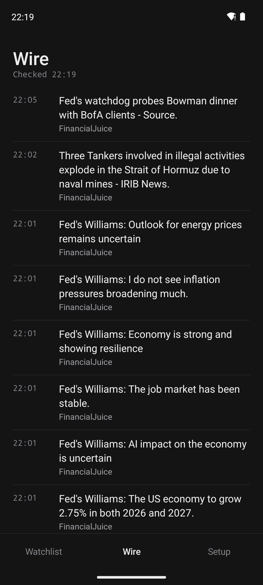
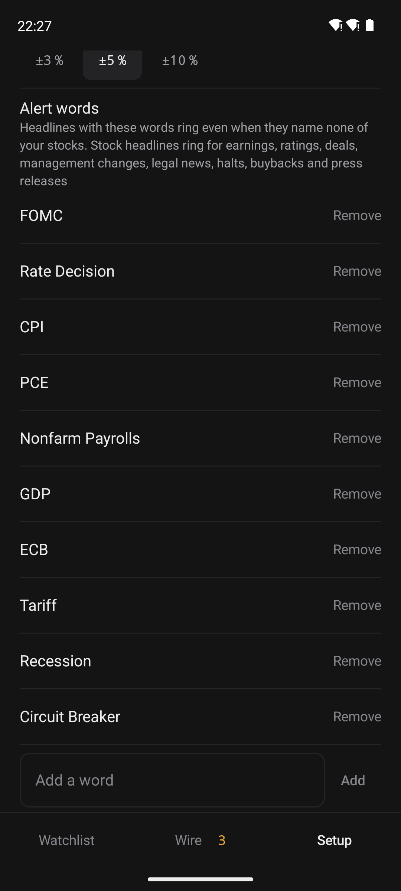

<h1 align="center">Tape: breaking market news for your watchlist (Android, open source)</h1>

<p align="center"><strong>Pick your stocks and get a push when one moves 5 % or reports earnings, a deal or a management change. Fed decisions and inflation data ring too, and a live market wire sits one tab over. Headlines go straight from Yahoo Finance, Google News and FinancialJuice to your phone. No ads, no account, no server. Free, open source, English and German.</strong></p>

<p align="center">
  <a href="https://kotlinlang.org/"></a>
  <br>
  <a href="#install"></a>
  <a href="#privacy"></a>
  <a href="https://developer.android.com/compose"></a>
  <a href="https://github.com/BrickyStudios/tape/actions/workflows/ci.yml"></a>
  <a href="LICENSE"></a>
</p>

<p align="center">
  <a href="https://github.com/BrickyStudios/tape/releases/latest/download/Tape.apk"></a>
</p>

<p align="center">
  
  
  
</p>

<p align="center">
  <a href="#install">Install</a> ·
  <a href="#how-it-works">How it works</a> ·
  <a href="#sources">Sources</a> ·
  <a href="#privacy">Privacy</a> ·
  <a href="#limits">Limits</a> ·
  <a href="#build-it-yourself">Build</a> ·
  <a href="#auf-deutsch">Deutsch</a>
</p>

Tape keeps two lists. **Watchlist** shows headlines that name one of your stocks, with today's move next to each symbol. **Wire** shows the market headlines as they come in. Three things ring: a price move past your threshold, an event about one of your stocks, or a market headline with one of your alert words.

## Install

Download [Tape.apk](https://github.com/BrickyStudios/tape/releases/latest/download/Tape.apk) and open it. Android asks once whether your browser may install apps. Tape needs Android 8.0 or newer and no Google services.

Tape updates itself. When a newer release is on GitHub, a bar at the top offers to install it. Android only accepts the update when it carries the same signing key.

## How it works

1. **Add stocks** under Setup by symbol or company name (`AMZN`, `amazon`). The search comes from Yahoo Finance.
2. **Tape checks** the wire every minute on weekdays from 2:00 to 18:00 New York time and every 15 minutes otherwise. It searches news for each stock every 5 minutes, and right away when you pull down.
3. **A headline counts for a stock** when it names the company or the symbol: `Amazon`, `AMZN`, `$AMZN`. Yahoo's search also returns fund lists and market wraps that only mention a stock in passing. In a test with 8 stocks, fewer than half of its results named the company, so Tape drops the rest.
4. **Price moves ring** when a stock crosses ±5 % against yesterday's close, then again at ±10 %, ±15 % and so on, once a day per step. You can set 3, 5 or 10 % under Setup. A stock you just added starts quietly.
5. **Stock headlines ring** only for events: earnings and guidance, analyst up- or downgrades, deals, management changes, lawsuits and regulators, trading halts, buybacks and dividend changes, big moves, and press releases from Business Wire, PR Newswire or GlobeNewswire. Questions ("Can revenue accelerate?") and lists ("3 stocks to buy") stay in the list without a sound, and the event shows as a label next to the headline.
6. **Market headlines ring** when they contain an alert word. The defaults are FOMC, Rate Decision, CPI, PCE, Nonfarm Payrolls, GDP, ECB, Tariff, Recession and Circuit Breaker, and you can add or remove words. Several matches in one check, like the CPI lines, arrive as one notification.
7. **At night** (22:00 to 07:00 phone time) alerts arrive without sound. You can switch that off.
8. **Read alerts aloud** is off by default. When it is on, Tape speaks up to 3 alerts per check in English ("NVDA up 31.5 percent").
9. **The clock column** turns amber for headlines younger than 10 minutes, and a tab you are not on shows how many headlines came since you last looked.

On Android 13 and newer, checks on the minute work out of the box. On Android 12, allow **Exact timing** under Setup. If your phone's battery saver is aggressive, set **Battery** to unrestricted. **Sources** under Setup shows when each source last answered and why one failed. After an HTTP 429, Tape leaves that server alone for as long as it asks, 5 minutes by default.

## Sources

| Source | What | Notes |
|---|---|---|
| Yahoo Finance search | News per stock, stock lookup | Unofficial endpoint, can change or refuse at any time |
| Yahoo Finance spark | Today's price and yesterday's close | Unofficial endpoint, regular session only, one request per 20 stocks |
| Google News RSS | News per stock when Yahoo fails | |
| FinancialJuice RSS | Market wire | On by default, switch it off under Setup |
| Any RSS feed | Market wire | Add an https address under Setup |

Tape shows the headline and links to the source. It copies no articles and keeps no archive beyond the last 600 headlines on your phone. Tape is not affiliated with Yahoo, Google or FinancialJuice.

## Privacy

- No account, no analytics, no server of our own.
- Your watchlist and settings stay on the phone and are excluded from Android backups.
- The phone talks directly to Yahoo Finance, Google News, your feeds and GitHub (update check). Those services see your IP address, and Yahoo sees your symbols: the price check asks for all of them every minute while markets are open.
- Reading aloud uses the text-to-speech engine on your phone.

## Limits

- Fixed market hours, no exchange holidays. Price alerts cover the regular session, not pre- or after-market trading.
- Event detection uses English keyword lists. An unusually worded headline can slip through quietly; it still shows in the list.
- A headline that never names the company is missed, even when the article is about it.
- No earnings or dividend calendar yet: Yahoo's endpoint for it needs a login token.
- Symbols with one or two letters (`PG`, `GE`) only match by company name, because the letters turn up in too many abbreviations. Tape knows a few other names: `Google` for Alphabet, `P&G` for Procter & Gamble, `Facebook` for Meta.
- The sources are English-language, so news on European stocks may be sparse.
- Nothing in Tape is investment advice.

## Build it yourself

JDK 17 and the Android SDK:

```
./gradlew testDebugUnitTest assembleDebug
```

The tests in `app/src/test` cover parsing, matching, event detection, price steps, quiet hours and timing with sample feeds.

## Auf Deutsch

Tape zeigt Börsen-News zu deinen Aktien und einen Live-Ticker mit Marktmeldungen, ohne Werbung, ohne Konto, ohne Server. Eine Meldung zählt für eine Aktie, wenn die Schlagzeile Firma oder Symbol nennt. Laut wird es nur bei einer Kursbewegung ab ±5 % (einstellbar), bei Ereignissen wie Quartalszahlen, Übernahmen oder Führungswechseln und bei Marktmeldungen mit deinen Alarmwörtern, etwa Fed-Zinsentscheid oder Inflationsdaten. Nachts kommen Alarme ohne Ton. Die App ist auf Deutsch und Englisch, Download über [Tape.apk](https://github.com/BrickyStudios/tape/releases/latest/download/Tape.apk). Keine Anlageberatung.

## License

[GPL-3.0](LICENSE)
