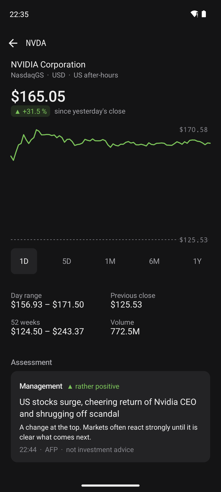
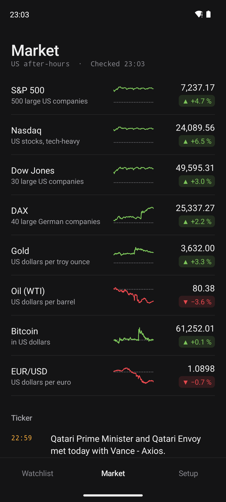
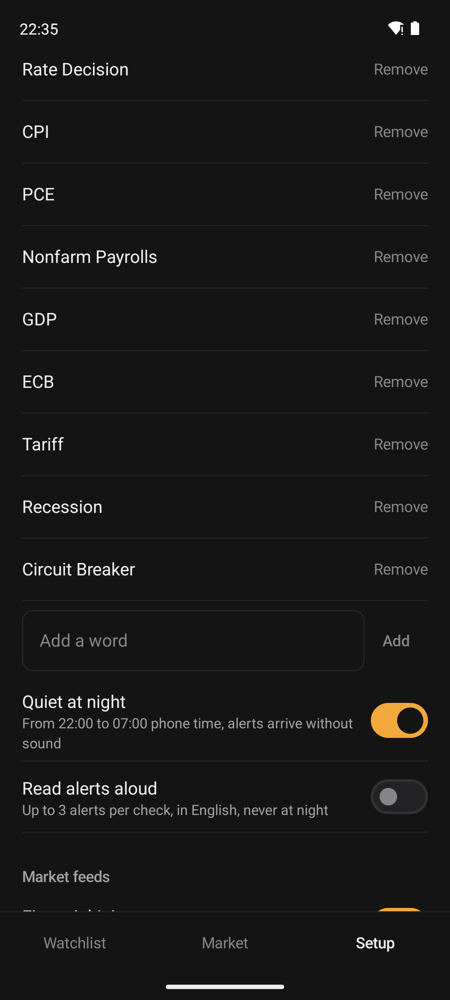

<h1 align="center">Tape: stock prices and the news that moves them (Android, open source)</h1>

<p align="center"><strong>Your stocks with price, today's line and change, the ones you own on top. Search any stock or ETF by name, symbol or ISIN, and see its chart, its news and where it stands against its 200-day line, 52-week low and RSI. Tap one for a one-sentence note on what the latest news means. A push comes when a stock moves 5 % or reports earnings, a deal or a management change, and Fed decisions and inflation data ring too. The Market tab shows Europe, the US with its futures and Asia, with whatever trades right now on top. US stocks also show their pre-market and after-hours move. The Dates tab lists the week's earnings and economic releases, and the Market tab reads the mood: the VIX, how professionals are positioned, and what Reddit's stock forums talk about. Headlines go straight from Yahoo Finance, Seeking Alpha, Google News, FinancialJuice and Bloomberg to your phone, and from onvista, Handelsblatt and FAZ if you switch on German sources. No ads, no account, no server. Free, open source, English and German.</strong></p>

<p align="center">
  <a href="https://kotlinlang.org/"></a>
  <br>
  <a href="#install"></a>
  <a href="#privacy"></a>
  <a href="https://developer.android.com/compose"></a>
  <a href="https://github.com/BrickyStudios/tape/actions/workflows/ci.yml"></a>
  <a href="LICENSE"></a>
</p>

<p align="center">
  <a href="https://github.com/BrickyStudios/tape/releases/latest/download/Tape.apk"></a>
</p>

<p align="center">
  
  
  
  
</p>

<p align="center">
  <a href="#install">Install</a> ·
  <a href="#how-it-works">How it works</a> ·
  <a href="#sources">Sources</a> ·
  <a href="#privacy">Privacy</a> ·
  <a href="#limits">Limits</a> ·
  <a href="#build-it-yourself">Build</a> ·
  <a href="#auf-deutsch">Deutsch</a>
</p>

**Watchlist** shows each of your stocks with price, today's line and change, then the day's important headlines about them. Tap a stock for its **detail page**: chart over 1 day to 1 year (hold a finger on it to read any point), day range, 52 weeks, volume, an **assessment** that says in one sentence what the latest event means, and all its news. **Market** groups indices by region: Europe (DAX, Euro Stoxx 50, FTSE 100, CAC 40, SMI), the US (S&P 500, Nasdaq, Dow Jones and the S&P 500 and Nasdaq 100 futures) and Asia (Nikkei 225, Hang Seng, Shanghai). Whatever trades now is on top, with its closing time; then gold, oil, bitcoin, EUR/USD and the news ticker. Three things ring: a price move past your threshold, an event about one of your stocks, or a market headline with one of your alert words.

## Install

Download [Tape.apk](https://github.com/BrickyStudios/tape/releases/latest/download/Tape.apk) and open it. Android asks once whether your browser may install apps. Tape needs Android 8.0 or newer and no Google services.

Tape updates itself. When a newer release is on GitHub, a bar at the top offers to install it. Android only accepts the update when it carries the same signing key.

## How it works

1. **Find stocks** with the search button beside the tabs, by name, symbol or ISIN (`AAPL`, `apple`, `US0378331005`). The search comes from Yahoo Finance. A stock's page works before you add it: chart, news, buying chance. **Watch** puts it on your Watchlist, **I own this** lists it under In my portfolio, on top.
2. **Tape checks** the ticker feeds every minute on weekdays from 2:00 to 18:00 New York time and every 15 minutes otherwise. It searches news for each stock every 5 minutes, and right away when you pull down.
3. **A headline counts for a stock** when it names the company or the symbol: `Amazon`, `AMZN`, `$AMZN`. Yahoo's search also returns fund lists and market wraps that only mention a stock in passing. In a test with 8 stocks, fewer than half of its results named the company, so Tape drops the rest.
4. **Price moves ring** when a stock crosses ±5 % against yesterday's close, then again at ±10 %, ±15 % and so on, once a day per step. You can set 3, 5 or 10 % under Setup. A stock you just added starts quietly.
5. **Stock headlines ring** only for events: earnings and guidance, analyst up- or downgrades, deals, management changes, lawsuits and regulators, trading halts, buybacks and dividend changes, and press releases from Business Wire, PR Newswire or GlobeNewswire. Each stock rings once per kind of event in 12 hours: when Reuters, Seeking Alpha and Bloomberg report the same CEO change, the first one rings and the others wait in the list. Headlines about a big move get a label but no sound, because the price alert covers the move. Questions ("Can revenue accelerate?") and lists ("3 stocks to buy") stay in the list without a sound, and the event shows as a label next to the headline.
6. **Market headlines ring** when they contain an alert word. The defaults are FOMC, Rate Decision, CPI, PCE, Nonfarm Payrolls, GDP, Tariff, Recession and Circuit Breaker, and you can add or remove words. Several matches in one check, like the CPI lines, arrive as one notification, and each word rings at most once an hour.
7. **At night** (22:00 to 07:00 phone time) alerts arrive without sound. You can switch that off.
8. **Read alerts aloud** is off by default. When it is on, Tape speaks up to 3 alerts per check in English ("NVDA up 31.5 percent").
9. **Only alerts make noise.** The ticker in the notification shade, which always showed the newest headline, is off by default; switch it on under Setup.
10. **The clock column** turns amber for headlines younger than 10 minutes, and a tab you are not on shows how many headlines came since you last looked.
11. **In the morning** Europe sits on top of the Market tab and the US futures show how Wall Street is set to open. US stocks show last night's after-hours price, and from 10:00 Frankfurt time their pre-market price. On weekdays around 9:25 Frankfurt time a silent **morning overview** sums it up: DAX, Euro Stoxx 50, FTSE 100, the US futures, Nikkei and Hang Seng. Switch it off under Setup.
12. **Dates** is the weekly calendar that r/wallstreetbets ("Most Anticipated Earnings") and r/mauerstrassenwetten ("Erntenkalender") post by hand: per day the economic releases in plain words ("Core inflation (PCE)", not "Core PCE Price Index m/m") and the earnings, your stocks first. A stock on your watchlist shows "Earnings Thu 22:00" in its row a week ahead.
13. **Mood** on the Market tab: the VIX with a word for its level (calm, normal, nervous, panic), two sentences on how asset managers and hedge funds are positioned in the S&P 500 future according to the CFTC's weekly report, and the 5 most named stocks on Reddit with their move today, the way the community-built MSW Daily App shows them. **Reddit posts** (off by default) adds the 3 most discussed research, news, strategy and discussion posts from each of the two forums, without memes.
14. **Buying chance** on each stock's page checks four rules of thumb against today's price: within 5 % under and 3 % over the 200-day line, at most 5 % above the 52-week low, at least 20 % under the 52-week high, and an RSI under 30 over 14 days. Each rule shows its number and an amber tick when it holds; the first one that holds also shows in the stock's row ("Near its 52-week low"). A stock far under its 200-day line is in a falling trend, so that rule only counts near the line. These are rules of thumb, not advice.
15. **German sources** under Setup (off by default) add onvista, Handelsblatt and FAZ to the ticker. Their headlines count for your stocks the same way, by company name, and get an event and a tone from German keywords. Ads that slip into a feed ("50 % Rabatt") are dropped.

On Android 13 and newer, checks on the minute work out of the box. On Android 12, allow **Exact timing** under Setup. If your phone's battery saver is aggressive, set **Battery** to unrestricted. **Sources** under Setup shows when each source last answered and why one failed. After an HTTP 429, Tape leaves that server alone for as long as it asks, 5 minutes by default.

## Sources

| Source | What | Notes |
|---|---|---|
| Yahoo Finance search | News per stock, stock lookup | Unofficial endpoint, can change or refuse at any time |
| Yahoo Finance spark | Today's price, yesterday's close, the day's line, pre-market and after-hours trades | Unofficial endpoint, one request per 20 symbols. European index prices lag about 15 minutes |
| Seeking Alpha RSS | News per stock: analyst ratings, insider trades, company news | One feed per US stock, every 5 minutes. Skips opinion articles |
| Google News RSS | News per stock when Yahoo fails | |
| Yahoo Finance chart | Detail page chart and day figures | Unofficial endpoint, loaded when you open a stock, kept 5 minutes |
| Yahoo Finance spark, 1 year daily | 200-day line, 52-week range and RSI for the buying chance | Unofficial endpoint, every 6 hours for your stocks, once an hour for a stock you look up |
| FinancialJuice RSS | Ticker | On by default, switch it off under Setup |
| Bloomberg RSS | Ticker | Bloomberg's public headline feed; articles open on bloomberg.com |
| CNBC Markets RSS | Ticker | Off by default, switch it on under Setup |
| onvista, Handelsblatt, FAZ RSS | Ticker in German | Off by default, switch on German sources under Setup. finanzen.net refuses apps |
| Any RSS feed | Ticker | Add an https address under Setup |
| ForexFactory calendar export | Economic releases of the week | Public JSON, every 3 hours |
| Yahoo Finance calendar | Earnings dates and estimates | Unofficial endpoint, every 3 hours; a date shows once the company has announced it |
| CFTC Traders in Financial Futures | Positioning in the S&P 500 E-mini future | The US regulator's open data, weekly, checked every 6 hours |
| ApeWisdom | Most named stocks on Reddit | Every 30 minutes |
| Arctic Shift | Reddit posts | Only when switched on; a free, volunteer-run Reddit archive, because Reddit blocks apps without a login |

Tape shows the headline and links to the source. It copies no articles and keeps no archive beyond the last 600 headlines on your phone. Tape is not affiliated with Yahoo, Seeking Alpha, Google, FinancialJuice, Bloomberg, CNBC, onvista, Handelsblatt or FAZ.

## Privacy

- No account, no analytics, no server of our own.
- Your watchlist and settings stay on the phone and are excluded from Android backups.
- The phone talks directly to Yahoo Finance, Seeking Alpha, Google News, ForexFactory, the CFTC, ApeWisdom, your feeds and GitHub (update check), to Arctic Shift when Reddit posts are on, and to onvista, Handelsblatt and FAZ when German sources are on. None of them gets your watchlist except Yahoo (prices and earnings dates) and Seeking Alpha. Those services see your IP address. Yahoo and Seeking Alpha see your symbols: Yahoo's price check asks for all of them every minute while markets are open (the market rows every 5 minutes while Tape is in the background), Seeking Alpha gets one request per US stock every 5 minutes.
- Reading aloud uses the text-to-speech engine on your phone.

## Limits

- Fixed market hours, no exchange holidays, lunch breaks in Asia ignored. Price alerts cover the regular session: pre-market and after-hours moves show, but do not ring.
- The assessment ("rather positive", "rather negative") reads keywords and phrases in the headline. On 74 hand-labelled headlines from 25.11.2026 it read all of them the way a person would; the list before 0.7.0 got 35 of the first 68. It describes the wording and predicts nothing about the price.
- Event detection uses English and German keyword lists. An unusually worded headline can slip through quietly; it still shows in the list.
- A headline that never names the company is missed, even when the article is about it.
- No earnings or dividend calendar yet: Yahoo's endpoint for it needs a login token.
- Symbols with one or two letters (`PG`, `GE`) only match by company name, because the letters turn up in too many abbreviations. Tape knows a few other names: `Google` for Alphabet, `P&G` for Procter & Gamble, `Facebook` for Meta.
- Without German sources the feeds are English-language, so news on European stocks may be sparse.
- The economic calendar has no actual figures; they arrive as FinancialJuice headlines. CNN's Fear & Greed Index refuses apps, so Tape shows the VIX instead. The CFTC figures are a week old when they come out. Reddit mention counts cover English-speaking forums; r/mauerstrassenwetten only appears through its posts.
- Nothing in Tape is investment advice.

## Build it yourself

JDK 17 and the Android SDK:

```
./gradlew testDebugUnitTest assembleDebug
```

The tests in `app/src/test` cover parsing, matching, event detection, tone, price steps, charts, market hours, number formats, quiet hours and timing with sample feeds.

## Auf Deutsch

Tape zeigt deine Aktien mit Kurs, Tagesverlauf und Änderung, pro Aktie eine Detailseite mit Chart und einer Einordnung der letzten Meldung in einem Satz, dazu Indizes aus Europa, den USA (mit Futures) und Asien, Gold, Öl, Bitcoin, EUR/USD und einen Live-Ticker. Was gerade handelt, steht oben. US-Aktien zeigen ihren vor- und nachbörslichen Kurs. Werktags gegen 9:25 Uhr fasst ein stiller Morgenüberblick zusammen, wie Europa gestartet ist. Über die Lupe neben den Tabs findest du jede Aktie und jeden ETF nach Name, Symbol oder ISIN, mit Chart, Nachrichten und Kaufchance: 200-Tage-Linie, 52-Wochen-Tief, Abstand zum Jahreshoch und RSI, jeweils mit Zahl. Mit Merken oder Hab ich landet sie auf der Watchlist, was du besitzt, steht oben unter Im Depot. Der Tab Termine zeigt die Quartalszahlen und Wirtschaftsdaten der Woche in Klartext, der Markt-Tab die Stimmung: den VIX, wie Fondsmanager und Hedgefonds laut US-Aufsicht CFTC positioniert sind, und die meistgenannten Aktien auf Reddit. Auf Wunsch kommen fundierte Beiträge aus r/wallstreetbets und r/mauerstrassenwetten dazu, ohne Memes, und deutsche Quellen: onvista, Handelsblatt und FAZ. Ohne Werbung, ohne Konto, ohne Server. Eine Meldung zählt für eine Aktie, wenn die Schlagzeile Firma oder Symbol nennt. Laut wird es nur bei einer Kursbewegung ab ±5 % (einstellbar), bei Ereignissen wie Quartalszahlen, Übernahmen oder Führungswechseln und bei Marktmeldungen mit deinen Alarmwörtern, etwa Fed-Zinsentscheid oder Inflationsdaten. Dieselbe Meldung von mehreren Quellen klingelt nur einmal, jedes Alarmwort höchstens einmal pro Stunde. Nachts kommen Alarme ohne Ton. Die App ist auf Deutsch und Englisch, Download über [Tape.apk](https://github.com/BrickyStudios/tape/releases/latest/download/Tape.apk). Keine Anlageberatung.

## License

[GPL-3.0](LICENSE)
