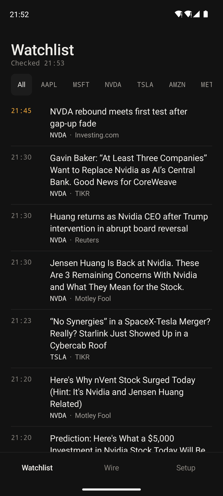

<h1 align="center">Tape: breaking market news for your watchlist (Android, open source)</h1>

<p align="center"><strong>Pick your stocks and get a push when a headline names one of them. A live market wire sits one tab over. Headlines go straight from Yahoo Finance, Google News and FinancialJuice to your phone. No ads, no account, no server. Free, open source, English and German.</strong></p>

<p align="center">
  <a href="https://kotlinlang.org/"></a>
  <br>
  <a href="#install"></a>
  <a href="#privacy"></a>
  <a href="https://developer.android.com/compose"></a>
  <a href="https://github.com/BrickyStudios/tape/actions/workflows/ci.yml"></a>
  <a href="LICENSE"></a>
</p>

<p align="center">
  <a href="https://github.com/BrickyStudios/tape/releases/latest/download/Tape.apk"></a>
</p>

<p align="center">
  
  
  
</p>

<p align="center">
  <a href="#install">Install</a> ·
  <a href="#how-it-works">How it works</a> ·
  <a href="#sources">Sources</a> ·
  <a href="#privacy">Privacy</a> ·
  <a href="#limits">Limits</a> ·
  <a href="#build-it-yourself">Build</a> ·
  <a href="#auf-deutsch">Deutsch</a>
</p>

Finance apps bury the news about your stocks between ads, videos and market wraps. Tape keeps two lists. **Watchlist** shows headlines that name one of your stocks. **Wire** shows the market headlines as they come in. A headline about one of your stocks also arrives as a notification.

## Install

Download [Tape.apk](https://github.com/BrickyStudios/tape/releases/latest/download/Tape.apk) and open it. Android asks once whether your browser may install apps. Tape needs Android 8.0 or newer and no Google services.

Tape updates itself: when a newer release is on GitHub, a bar at the top offers to install it. Android only accepts the update when it carries the same signing key.

## How it works

1. **Add stocks** under Setup by symbol or company name (`AMZN`, `amazon`). The search comes from Yahoo Finance.
2. **Tape checks** the wire every minute on weekdays from 2:00 to 18:00 New York time and every 15 minutes otherwise. It searches news for each stock every 5 minutes, and right away when you pull down.
3. **A headline counts for a stock** when it names the company or the symbol: `Amazon`, `AMZN`, `$AMZN`. Yahoo's search also returns fund lists and market wraps that only mention a stock in passing. In a test with 8 stocks, fewer than half of its results named the company, so Tape drops the rest.
4. **Notifications:** one per new headline about your stocks, tap it to read the article. Wire headlines update one silent notification.
5. **The clock column** turns amber for headlines younger than 10 minutes.

For checks on the minute, allow **Exact timing** and set **Battery** to unrestricted under Setup. Without them, Android may hold checks back for several minutes.

## Sources

| Source | What | Notes |
|---|---|---|
| Yahoo Finance search | News per stock, stock lookup | Unofficial endpoint, can change or refuse at any time |
| Google News RSS | News per stock when Yahoo fails | |
| FinancialJuice RSS | Market wire | On by default, switch it off under Setup |
| Any RSS feed | Market wire | Add an https address under Setup |

Tape shows the headline and links to the source. It copies no articles and keeps no archive beyond the last 600 headlines on your phone. Tape is not affiliated with Yahoo, Google or FinancialJuice.

## Privacy

- No account, no analytics, no server of our own.
- Your watchlist and settings stay on the phone and are excluded from Android backups.
- The phone talks directly to Yahoo Finance, Google News, your feeds and GitHub (update check). Those services see your IP address, and Yahoo sees which symbols you search.

## Limits

- Fixed market hours, no exchange holidays.
- A headline that never names the company is missed, even when the article is about it.
- Symbols with one or two letters (`PG`, `GE`) only match by company name, because the letters turn up in too many abbreviations. Tape knows a few other names: `Google` for Alphabet, `P&G` for Procter & Gamble, `Facebook` for Meta.
- English-language sources. News on European stocks is thin.
- Nothing in Tape is investment advice.

## Build it yourself

JDK 17 and the Android SDK:

```
./gradlew testDebugUnitTest assembleDebug
```

The tests in `app/src/test` cover parsing, matching and timing with sample feeds.

## Auf Deutsch

Tape zeigt Börsen-News zu deinen Aktien und einen Live-Ticker mit Marktmeldungen, ohne Werbung, ohne Konto, ohne Server. Eine Meldung zählt für eine Aktie, wenn die Schlagzeile Firma oder Symbol nennt. Dann kommt eine Benachrichtigung. Die App ist auf Deutsch und Englisch, Download über [Tape.apk](https://github.com/BrickyStudios/tape/releases/latest/download/Tape.apk). Keine Anlageberatung.

## License

[GPL-3.0](LICENSE)
